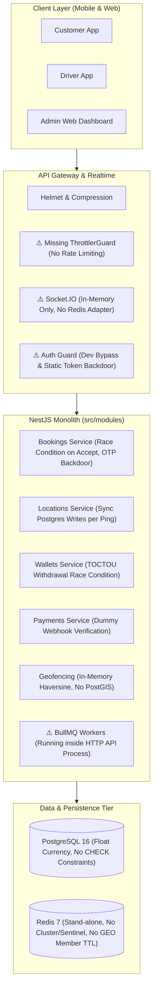

# Raftar Gaddi – Backend Engineering Audit
# Document 00: Executive Summary & System Scorecard

**Target System:** Raftar Gaddi Backend (`RaftarGadi-Backend`)  
**Platform Classification:** On-Demand Goods Transportation & Logistics Platform  
**Audit Conducted By:** Principal Software Architect, Senior NestJS Backend Engineer, Database Architect, DevOps Engineer, Application Security Specialist, and Performance Engineer  
**Audit Date:** November 2026  
**Audit Status:** AUDIT ONLY (No code, schema, dependency, or configuration modifications made)

---

## 1. Overall Production Readiness Verdict

> [!CAUTION]
> **VERDICT: STRICT NO-GO FOR PRODUCTION DEPLOYMENT**  
> The Raftar Gaddi backend in its current state contains **severe authentication bypasses, critical financial integrity vulnerabilities, privacy-breaching real-time data leaks, database race conditions, and unhandled high-frequency I/O bottlenecks**. Deploying the backend in its present state would result in unauthorized admin access, driver impersonation, financial theft via wallet exploitation, systemic database connection collapse under moderate load, and regulatory non-compliance with UIDAI Aadhaar data protection laws.

### Overall Production Readiness Score: **34 / 100 (Critical Risk)**

```
Overall System Health Score: [███████░░░░░░░░░░░░░] 34%
─────────────────────────────────────────────────────────────
Security & Authentication      : 18 / 100  (CRITICAL FAILURE)
Financial & Payment Integrity  : 22 / 100  (CRITICAL FAILURE)
Real-time & WebSocket Systems  : 28 / 100  (CRITICAL FAILURE)
Database Architecture & Schema : 42 / 100  (POOR)
Dispatch & Business Logic      : 35 / 100  (POOR)
Performance & Scalability      : 38 / 100  (POOR)
Observability & Telemetry      : 40 / 100  (POOR)
DevOps, Container & Deployment : 36 / 100  (POOR)
Test Coverage & Quality        : 26 / 100  (CRITICAL FAILURE)
Regulatory & Compliance        : 20 / 100  (CRITICAL FAILURE)
─────────────────────────────────────────────────────────────
```

---

## 2. Category Scorecard Breakdown

| Domain | Weight | Score | Rating | Primary Root Cause |
|---|---|---|---|---|
| **Security & Authentication** | 15% | **18 / 100** | 🔴 Critical | Dev auth bypass in `JwtAuthGuard`, static demo tokens, insecure PRNG OTP, missing token revocation. |
| **Financial & Payment Integrity** | 15% | **22 / 100** | 🔴 Critical | Dummy webhook signature `'valid-signature'`, TOCTOU withdrawal race conditions, IEEE 754 Float money. |
| **Real-time & WebSockets** | 10% | **28 / 100** | 🔴 Critical | Unsigned JWT decode fallback, `server.emit` leaking PII to all clients, unattached Redis adapter. |
| **Database Architecture** | 10% | **42 / 100** | 🟠 High Risk | No CHECK constraints, Float balance/fares, sync high-frequency writes per GPS ping, missing PostGIS. |
| **Dispatch & Business Logic** | 10% | **35 / 100** | 🟠 High Risk | Concurrency race in booking acceptance, OTP `'1234'` backdoor, dispatch matching algorithm unbuilt. |
| **Performance & Scalability** | 10% | **38 / 100** | 🟠 High Risk | Sequential N+1 Redis queries, sync DB writes on GPS pings, in-memory O(N) Haversine loops. |
| **Observability & Telemetry** | 5% | **40 / 100** | 🟠 High Risk | `RequestIdMiddleware` unregistered, `GlobalExceptionFilter` dead code, missing APM & metrics. |
| **DevOps & Infrastructure** | 10% | **36 / 100** | 🟠 High Risk | Bloated production Dockerfile, exposed DB/Redis ports, plaintext passwords in compose, no healthchecks. |
| **Testing & Code Quality** | 10% | **26 / 100** | 🔴 Critical | 3 failing unit test suites, 0 E2E tests, 0 integration tests, 860 lint issues (164 errors). |
| **Compliance & Data Privacy** | 5% | **20 / 100** | 🔴 Critical | Raw unencrypted Aadhaar stored in DB (violates Indian Aadhaar Act Sec 29 & UIDAI regulations). |

---

## 3. Top 10 Most Critical Risks & Architectural Blockers

The following table summarizes the 10 most dangerous technical defects discovered in the codebase, with exact code citations and impacts:

| # | Vulnerability / Defect | Location | Severity | Technical Impact & Exploitation Vector |
|---|---|---|---|---|
| **1** | **Universal Dev Auth Bypass & Demo Token Backdoor** | `src/common/guards/jwt-auth.guard.ts` (L38-60, L71-91) | **CRITICAL** | If `NODE_ENV !== 'production'`, any unauthenticated request is granted full `ADMIN` or `DRIVER` role. If an invalid token is passed, `'demo_admin_jwt_token_123'` grants immediate admin privileges. |
| **2** | **WebSocket Impersonation via Unsigned JWT Decode** | `src/modules/locations/gateways/location.gateway.ts` (L51-56) | **CRITICAL** | If `jwtService.verify(token)` throws, code falls back to `jwtService.decode(token)`. An attacker can forge any JWT with arbitrary `sub` and `role: 'ADMIN'` to hijack any connection. |
| **3** | **Dummy Payment Webhook Signature Verification** | `src/modules/payments/services/payments.service.ts` (L48-50) | **CRITICAL** | Webhook verification checks `payload.signature !== 'valid-signature'`. Anyone can POST arbitrary order completion payloads with `"signature": "valid-signature"` and mark any ride as paid. |
| **4** | **Booking Start-Trip OTP Backdoor & Null Bypass** | `src/modules/bookings/services/bookings.service.ts` (L607-610) | **CRITICAL** | Driver can start any ride using hardcoded `'1234'`. Furthermore, `if (otp && ...)` bypasses the check entirely if `otp` is omitted in the request. |
| **5** | **Driver Acceptance Concurrency Race Condition** | `src/modules/bookings/services/bookings.service.ts` (L513-543) | **CRITICAL** | `driverAcceptBooking` uses standard `findUnique` followed by `update` in Read Committed isolation without row-level locking (`FOR UPDATE`) or atomic CAS, allowing multiple drivers to claim the same order. |
| **6** | **Wallet Double-Spend & Negative Balance TOCTOU** | `src/modules/wallets/services/wallets.service.ts` (L154-167) | **CRITICAL** | Balance check in `processWithdrawal` happens outside the database transaction without locking or DB constraints (`CHECK balance >= 0`). Concurrent withdrawal requests drain funds into negative balances. |
| **7** | **Global Real-Time PII & Location Data Leakage** | `src/modules/locations/gateways/location.gateway.ts` (L413, L424, L448) | **CRITICAL** | `this.server.emit('booking:status')` and `'support:admin_update'` broadcast private trip coordinates, customer phone numbers, addresses, and chat messages to ALL connected sockets globally. |
| **8** | **Unauthenticated Support Chat & Stalking Endpoints** | `src/modules/locations/gateways/location.gateway.ts` (L427-434), `locations.controller.ts` (L63-77) | **CRITICAL** | `support:join` allows any socket to join any support ticket room without auth. `GET /locations/booking/:bookingId` leaks full trip PII and `startOtp` with zero authorization checks. |
| **9** | **PostgreSQL Connection Exhaustion on GPS Streams** | `src/modules/locations/gateways/location.gateway.ts` (L166-173) | **CRITICAL** | Every location ping (every 3–5s per active driver) performs a synchronous `SELECT` and `INSERT INTO booking_locations` in Postgres. At 5,000 active trips, 1,600+ QPS directly crashes the Postgres connection pool. |
| **10** | **Unencrypted Raw Aadhaar Storage (UIDAI Violation)** | `prisma/schema.prisma` (L220), `kyc-verification.service.ts` (L51) | **CRITICAL** | Storing unencrypted 12-digit Aadhaar numbers in plaintext violates Section 29 of the Aadhaar Act, 2016, and UIDAI regulations, exposing the company to severe criminal liabilities and regulatory shutdown. |

---

## 4. Key Architectural Findings



### Architectural Deficiencies Summary
1. **Clustered Scalability Lock**: Because `@socket.io/redis-adapter` is never bound in `main.ts`, the backend cannot scale horizontally across multiple container instances or Kubernetes pods.
2. **Process Coupling**: `JobsModule` BullMQ queue processors run directly inside the main HTTP API server process, causing heavy CPU tasks (PDF invoice generation, cleanup) to block the Node.js event loop for real-time requests.
3. **Dead Architecture**: Essential production middleware and filters (`GlobalExceptionFilter`, `ResponseInterceptor`, `RequestIdMiddleware`) were created in `src/common` but never registered in `main.ts` or `app.module.ts`.
4. **Financial Inaccuracy**: Currencies, wallet balances, and pricing rules are stored as IEEE 754 floating-point numbers (`Float`) instead of fixed-point decimals (`Decimal(12, 2)`), leading to accumulated rounding errors.

---

## 5. Remediation Roadmap Overview

To bring Raftar Gaddi to enterprise-grade, production-ready stability, the remediation must proceed in four sequential phases:

```
┌─────────────────────────────────────────────────────────────────────────────┐
│ PHASE 1: IMMEDIATE CRITICAL FIXES (Day 1 – 3)                               │
│ - Purge dev auth bypass & demo tokens from JwtAuthGuard                     │
│ - Fix WebSocket unsigned JWT decode fallback & restrict room broadcasting   │
│ - Enforce HMAC-SHA256 signature verification on payment webhooks            │
│ - Fix booking acceptance concurrency with SELECT FOR UPDATE / CAS update   │
│ - Secure start-trip OTP verification & eliminate '1234' backdoor            │
│ - Implement database transaction locking & CHECK constraints on wallets    │
└──────────────────────────────────────┬──────────────────────────────────────┘
                                       │
┌──────────────────────────────────────▼──────────────────────────────────────┐
│ PHASE 2: CORE ENGINEERING & DATA INTEGRITY (Week 1 – 2)                     │
│ - Migrate currency fields from Float to Decimal(12, 2) in Prisma            │
│ - Bind GlobalExceptionFilter, ResponseInterceptor, and RequestIdMiddleware │
│ - Register ThrottlerGuard globally for distributed rate limiting             │
│ - Attach RedisIoAdapter to enable multi-instance Socket.IO scaling          │
│ - Implement real Driver Matching & Dispatch algorithm                       │
│ - Encrypt Aadhaar using UIDAI-compliant vault/encryption                    │
└──────────────────────────────────────┬──────────────────────────────────────┘
                                       │
┌──────────────────────────────────────▼──────────────────────────────────────┐
│ PHASE 3: INFRASTRUCTURE, WORKERS & I/O OPTIMIZATION (Week 3 – 4)             │
│ - Buffer GPS telemetry via Redis Streams / in-memory batching before DB     │
│ - Decouple BullMQ worker processes cleanly from the HTTP API container       │
│ - Configure BullMQ job retention limits to prevent Redis OOM                │
│ - Multi-stage Dockerfile hardening (npm prune --production, non-root user)  │
│ - Redis Sentinel / Cluster failover configuration                           │
└──────────────────────────────────────┬──────────────────────────────────────┘
                                       │
┌──────────────────────────────────────▼──────────────────────────────────────┐
│ PHASE 4: PRODUCTION HARDENING, TESTING & COMPLIANCE (Week 5 – 6)            │
│ - Fix 3 failing unit test suites; achieve > 80% code coverage               │
│ - Build full E2E lifecycle test suite (Customer -> Driver -> Trip -> Pay)   │
│ - Integrate PostGIS for polygon-based municipal geofencing                  │
│ - Set up Prometheus metrics, Grafana dashboards, and Sentry APM             │
│ - Run k6 load testing to validate 5,000 concurrent active trips             │
└─────────────────────────────────────────────────────────────────────────────┘
```

---

## 6. Audit Deliverables Directory Guide

The subsequent 19 audit documents in this directory provide comprehensive, evidence-backed deep dives into each architectural subsystem:

- `01-architecture-audit.md`: Monolith structure, DI hygiene, circular dependencies, modular boundaries.
- `02-database-prisma-audit.md`: Schema modeling, indexing, Float vs Decimal, constraints, cascade risks.
- `03-auth-security-audit.md`: JWT bypass, OTP vulnerabilities, token revocation, RBAC/PBAC audit.
- `04-api-security-audit.md`: Rate limiting, authorization leaks, input sanitization, Swagger, headers.
- `05-booking-dispatch-audit.md`: Concurrency race conditions, OTP backdoor, state machine, dispatch algorithm.
- `06-geofencing-service-area-audit.md`: Haversine calculation, PostGIS absence, circular vs polygon limits.
- `07-socketio-realtime-audit.md`: Token verification, room leakage, global broadcasting, Redis adapter.
- `08-location-tracking-audit.md`: High-frequency DB writes, Redis GEO TTL gaps, location batching.
- `09-redis-distributed-systems-audit.md`: Memory policies, key namespacing, eviction risks, clustering.
- `10-bullmq-worker-audit.md`: Worker segregation, mock processors, job retention, DLQ patterns.
- `11-payment-wallet-audit.md`: Webhook signature forgery, withdrawal TOCTOU, negative balance, ledger audit.
- `12-performance-load-testing-audit.md`: 10K concurrency modeling, event loop blockers, connection pooling.
- `13-observability-audit.md`: Structured logging, PII sanitization, trace correlation, metrics, APM.
- `14-docker-devops-audit.md`: Dockerfile bloat, compose security, exposed ports, healthchecks, CI/CD.
- `15-testing-code-quality-audit.md`: Failing unit tests, 0 E2E tests, ESLint/Prettier analysis, type safety.
- `16-dependency-audit.md`: 69 npm vulnerabilities, CVE details, outdated packages, remediation scripts.
- `17-reliability-disaster-recovery-audit.md`: High availability, failover, backup strategies, circuit breakers.
- `18-production-readiness-checklist.md`: Exhaustive Go/No-Go readiness verification checklist.
- `19-prioritized-remediation-roadmap.md`: Implementation instructions, acceptance criteria, and timelines.
