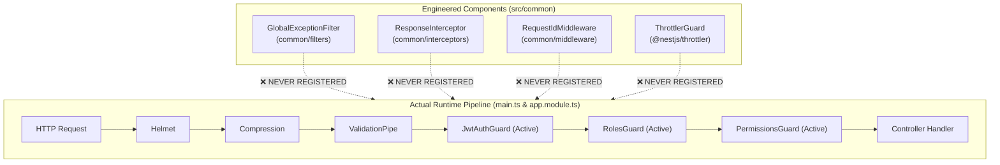

# Raftar Gaddi – Backend Engineering Audit
# Document 01: System Architecture & Modular Design Audit

**Audit Date:** November 2026  
**Auditor:** Principal Software Architect & Senior NestJS Backend Engineer  
**Component:** System Architecture, Module Topology, Dependency Injection, Middleware, and Cross-Cutting Concerns

---

## 1. Architectural Topology Overview

The Raftar Gaddi backend is implemented as a **NestJS 10 monolithic application** written in TypeScript 5, targeting Node.js 20. It adopts a modular monolith structure intended to separate business domains across 18 functional modules, 3 core infrastructure modules, and 1 background jobs module.

```
src/
├── app.module.ts             # Root application orchestrator
├── main.ts                   # HTTP & OpenAPI server bootstrap
├── common/                   # Cross-cutting decorators, filters, guards, interceptors, middleware
├── config/                   # ConfigModule, RedisModule, AppConfigService
├── database/                 # DatabaseModule, PrismaService
├── jobs/                     # BullMQ worker bootstrap & processors
└── modules/                  # 18 Functional domain modules
    ├── admin/                # Back-office operations & audit logging
    ├── auth/                 # Authentication, OTP, JWT, token management
    ├── bookings/             # Ride request lifecycle & state machine
    ├── coupons/              # Promo codes & discount logic
    ├── customers/            # Customer profile management
    ├── drivers/              # Driver onboarding, KYC, status
    ├── health/               # Terminus health probes
    ├── locations/            # Real-time GPS ingestion & WebSocket gateway
    ├── notifications/        # Notification dispatch (Push/SMS/Email)
    ├── payments/             # Payment initiation & webhook ingestion
    ├── pricing/              # Dynamic fare calculation & surge
    ├── ratings/              # Post-trip feedback & scoring
    ├── reports/              # Analytics & operational aggregation
    ├── serviceable-areas/    # Operational geofencing zones
    ├── support/              # Ticketing & support chat
    ├── users/                # Base user identities & roles
    ├── vehicles/             # Vehicle fleet catalog & assignments
    └── wallets/              # Driver wallet ledger & payouts
```

---

## 2. Critical Architectural Deficiencies

### 2.1 Ghost Architecture: The Unregistered Cross-Cutting Layer
A severe architectural defect discovered during inspection is that **three critical cross-cutting components were engineered in `src/common` but were never registered anywhere in the application lifecycle**. They exist as dead code, creating a false sense of security and reliability.



#### Evidence & Citations:
1. **Unregistered `GlobalExceptionFilter`** ([`src/common/filters/global-exception.filter.ts`](file:///home/hp/Applications/RaftarGadi/RaftarGadi-Backend/src/common/filters/global-exception.filter.ts#L18)):
   - Designed to normalize error envelopes, sanitize internal database error traces, and attach request IDs.
   - **Omission:** Neither `app.useGlobalFilters(new GlobalExceptionFilter())` in `main.ts` nor `{ provide: APP_FILTER, useClass: GlobalExceptionFilter }` in `app.module.ts` exists.
   - **Impact:** Any unhandled Prisma, Redis, or syntax error triggers NestJS's default Express error handler, leaking internal SQL errors, stack traces, and database connection strings directly to HTTP clients.
2. **Unregistered `ResponseInterceptor`** ([`src/common/interceptors/response.interceptor.ts`](file:///home/hp/Applications/RaftarGadi/RaftarGadi-Backend/src/common/interceptors/response.interceptor.ts#L15)):
   - Designed to wrap all API responses in a uniform `{ success: true, data: ..., timestamp: ... }` contract.
   - **Omission:** Never bound in `main.ts` via `app.useGlobalInterceptors()`.
   - **Impact:** API responses across different controllers return inconsistent top-level JSON structures, causing client deserialization crashes across Customer, Driver, and Admin applications.
3. **Unregistered `RequestIdMiddleware`** ([`src/common/middleware/request-id.middleware.ts`](file:///home/hp/Applications/RaftarGadi/RaftarGadi-Backend/src/common/middleware/request-id.middleware.ts#L6)):
   - Designed to generate and bind UUID `X-Request-ID` headers to requests and Pino logger context.
   - **Omission:** `AppModule` does NOT implement `NestModule` and contains no `configure(consumer: MiddlewareConsumer)` implementation.
   - **Impact:** Logs lack correlation IDs. Distributed tracing between HTTP requests, WebSocket events, and BullMQ jobs is completely non-existent.
4. **Inactive Rate Limiting (`ThrottlerGuard`)** ([`src/app.module.ts`](file:///home/hp/Applications/RaftarGadi/RaftarGadi-Backend/src/app.module.ts#L81-86, #L125-139)):
   - `ThrottlerModule.forRoot` is imported on lines 81–86, but `{ provide: APP_GUARD, useClass: ThrottlerGuard }` is missing from `providers`.
   - **Impact:** ZERO rate limiting is active on any route in the application, leaving OTP sending and login endpoints open to denial-of-service and brute-force attacks.

---

### 2.2 Process Coupling: API & BullMQ Worker Co-Location
In [`src/app.module.ts`](file:///home/hp/Applications/RaftarGadi/RaftarGadi-Backend/src/app.module.ts#L123), `JobsModule` is directly imported into `AppModule`.
In [`src/jobs/worker.ts`](file:///home/hp/Applications/RaftarGadi/RaftarGadi-Backend/src/jobs/worker.ts#L6), the standalone worker also initializes `AppModule`:
```typescript
// src/jobs/worker.ts: Line 6
const app = await NestFactory.createApplicationContext(AppModule);
```
And in `JobsModule` ([`src/jobs/jobs.module.ts`](file:///home/hp/Applications/RaftarGadi/RaftarGadi-Backend/src/jobs/jobs.module.ts#L31)):
```typescript
providers: [NotificationProcessor, EmailProcessor, InvoiceProcessor, CleanupProcessor],
```

#### Critical Structural Flaw:
Because `JobsModule` is imported by `AppModule`, the BullMQ processors (`InvoiceProcessor`, `CleanupProcessor`, etc.) are instantiated and active **inside the main HTTP API server process (`main.ts`)**.
- **CPU Theft:** When PDF invoices or notifications are processed, they execute within the HTTP server's Node.js event loop, degrading latency for real-time driver tracking and customer bookings.
- **Dual Processing Contention:** If both the `api` container and the `worker` container run concurrently (as defined in `docker-compose.yml`), both processes pull jobs simultaneously from the same queues, completely defeating the purpose of a standalone worker process.

---

### 2.3 Event-Driven Architecture: Single-Instance In-Memory Bus
The system utilizes `@nestjs/event-emitter` (`EventEmitter2`) for core domain events:
- `booking.created`
- `booking.status`
- `booking.trip_started`
- `booking.trip_completed`
- `support.message`

#### Scalability & Reliability Flaw:
`EventEmitter2` is an **in-memory, single-process event emitter**.
1. **No Cluster Delivery:** In a multi-replica deployment (Kubernetes, AWS ECS, or Docker Compose replicas), an event emitted on Replica 1 (e.g., `booking.status`) is NEVER received by event listeners on Replica 2 or Replica 3.
2. **Event Loss on Crash:** If a container restarts or crashes immediately after an event is emitted, in-flight events are permanently lost without retry or persistence.
3. **Recommendation:** Migrate domain event messaging from `EventEmitter2` to a durable distributed pub/sub broker (Redis Streams or BullMQ event queues).

---

### 2.4 Dependency Injection & Layering Violations
1. **Broken Test Isolation in Services:**
   - Multiple services directly query Prisma or Redis in constructors or private helper methods without mockable interfaces. For example, `WalletsService.resolveDriverId` calls `this.prisma.driver.findUnique`, but `prisma` was not injected into the unit test suite, causing `wallets.service.spec.ts` to crash.
2. **Missing Repository Abstraction Consistency:**
   - While modules like `BookingsModule`, `DriversModule`, and `WalletsModule` define repository classes (`BookingsRepository`, `DriversRepository`, `WalletsRepository`), services regularly bypass their repositories and execute raw `this.prisma.*` queries directly inside business logic methods (e.g., `bookings.service.ts` lines 86-96, 502-507, 513-548).
   - This creates dual persistence pathways, fragmented transaction boundaries, and makes unit testing without a live database impossible.

---

## 3. Evaluation of Module Boundaries

| Module | Cohesion | Coupling | Architectural Verdict | Key Issue |
|---|---|---|---|---|
| `auth` | Moderate | High | Needs Decoupling | Directly creates user in DB; OTP bypass and weak PRNG. |
| `bookings` | Low | Very High | **Refactor Required** | God-class (`bookings.service.ts` > 860 lines); handles state, payments, wallets, and geofencing. |
| `locations` | Low | Very High | **Refactor Required** | Combines WebSocket gateway, tracking, driver proximity, and synchronous DB writes. |
| `wallets` | High | High | Needs Transaction Locking | TOCTOU race conditions; missing DB CHECK constraints. |
| `payments` | Moderate | High | Needs Gateway Integration | Dummy webhook signatures; hardcoded payment amounts. |
| `serviceable-areas` | Moderate | Low | Needs PostGIS & Caching | In-memory O(N) Haversine loops; no GeoJSON polygon support. |
| `jobs` | Low | Very High | **Segregate Module** | Embedded directly in `AppModule`; runs in both API and worker. |

---

## 4. Architectural Remediation Recommendations

1. **Bootstrap Dead Architecture Immediately:**
   - Register `GlobalExceptionFilter` in `main.ts` via `app.useGlobalFilters(new GlobalExceptionFilter())`.
   - Register `ResponseInterceptor` in `main.ts` via `app.useGlobalInterceptors(new ResponseInterceptor())`.
   - Implement `NestModule` in `AppModule` and bind `RequestIdMiddleware` to all routes `*`.
   - Add `{ provide: APP_GUARD, useClass: ThrottlerGuard }` to `AppModule.providers`.
2. **Decouple BullMQ Workers from HTTP API:**
   - Create a dedicated `WorkerModule` imported ONLY by `src/jobs/worker.ts`.
   - Remove `JobsModule` processors from `AppModule` so the HTTP API container never executes background jobs.
3. **Replace In-Memory EventEmitter with Redis Streams:**
   - Replace `EventEmitter2` with a Redis Pub/Sub or Redis Streams adapter to allow real-time events to bridge across multi-instance API nodes.
4. **Enforce Repository Boundary:**
   - Disallow direct `this.prisma` calls inside `BookingsService` and `WalletsService`. All database operations must be channeled through repository methods to allow transaction injection and isolated mock testing.
