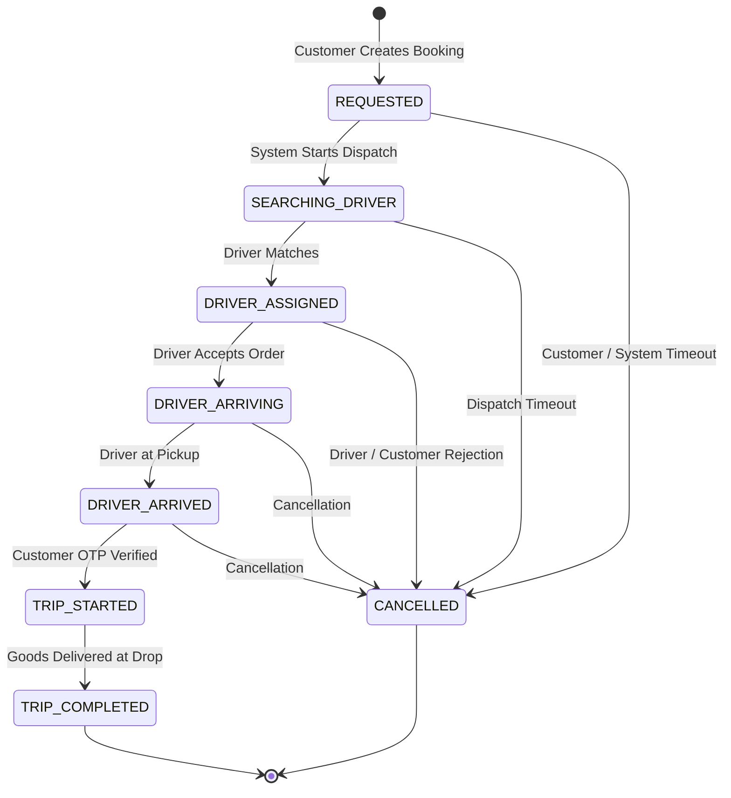

# Raftar Gaddi – Backend Engineering Audit
# Document 05: Booking Lifecycle, State Machine & Dispatch Engine Audit

**Audit Date:** November 2026  
**Auditor:** Senior Backend Engineer & Logistics Domain Architect  
**Component:** Booking State Transitions, Concurrency Control, OTP Verification, Dispatch Matching, and Fare Finalization

---

## 1. Booking Lifecycle & State Machine Architecture

The ride and delivery lifecycle in Raftar Gaddi is governed by `BookingStateMachineService` ([`src/modules/bookings/services/booking-state-machine.service.ts`](file:///home/hp/Applications/RaftarGadi/RaftarGadi-Backend/src/modules/bookings/services/booking-state-machine.service.ts)) and orchestrated by `BookingsService` ([`src/modules/bookings/services/bookings.service.ts`](file:///home/hp/Applications/RaftarGadi/RaftarGadi-Backend/src/modules/bookings/services/bookings.service.ts)).



---

## 2. Critical Concurrency & Logic Vulnerabilities

### 2.1 The Race Condition in Driver Acceptance (`driverAcceptBooking`)
In [`src/modules/bookings/services/bookings.service.ts`](file:///home/hp/Applications/RaftarGadi/RaftarGadi-Backend/src/modules/bookings/services/bookings.service.ts#L512-L543):

```typescript
// src/modules/bookings/services/bookings.service.ts: Lines 512-543
// Atomic assignment with database transaction
const updated = await this.prisma.$transaction(async (tx) => {
  const current = await tx.booking.findUnique({
    where: { id: bookingId },
  });
  if (!current) {
    throw new AppException('NOT_FOUND', 'Booking not found', HttpStatus.NOT_FOUND);
  }

  // Concurrency check: If already assigned or not in requestable state, reject with 409
  if (current.driverId != null || (current.status !== 'REQUESTED' && current.status !== 'SEARCHING_DRIVER')) {
    throw new AppException(
      'BOOKING_ALREADY_ACCEPTED',
      'This ride was already accepted by another driver',
      HttpStatus.CONFLICT,
    );
  }

  const result = await tx.booking.update({
    where: { id: bookingId },
    data: {
      status: 'DRIVER_ARRIVING',
      driverId: driver.id,
      vehicleId: driver.vehicle!.id,
      driverAssignedAt: new Date(),
    },
    ...
  });
  ...
  return result;
});
```

#### Why This Fails Under High Concurrency:
1. In PostgreSQL, standard `SELECT` queries (`tx.booking.findUnique`) **do not acquire row-level locks** under the default `READ COMMITTED` transaction isolation level.
2. If Driver A and Driver B click "Accept Order" within milliseconds of each other:
   - **T1:** Driver A's transaction reads `booking`: `driverId` is `null`, `status` is `'SEARCHING_DRIVER'`. Concurrency check passes.
   - **T2:** Driver B's transaction reads `booking`: `driverId` is `null`, `status` is `'SEARCHING_DRIVER'`. Concurrency check passes.
   - **T3:** Driver A's transaction writes `booking.update` setting `driverId = DriverA.id`. Transaction commits.
   - **T4:** Driver B's transaction writes `booking.update` setting `driverId = DriverB.id`. Transaction commits.
3. **Catastrophic Business Impact:** Driver A receives confirmation and starts driving to the pickup, but Driver B silently overwrites Driver A in the database! Two drivers arrive at the customer's doorstep for the same order.
4. **Remediation:** Use an atomic Compare-And-Swap (CAS) update query with row count validation:
   ```typescript
   const updatedCount = await tx.booking.updateMany({
     where: {
       id: bookingId,
       status: { in: ['REQUESTED', 'SEARCHING_DRIVER'] },
       driverId: null,
     },
     data: {
       status: 'DRIVER_ARRIVING',
       driverId: driver.id,
       vehicleId: driver.vehicle.id,
       driverAssignedAt: new Date(),
     },
   });

   if (updatedCount.count === 0) {
     throw new AppException(
       'BOOKING_ALREADY_ACCEPTED',
       'Ride has already been accepted by another driver',
       HttpStatus.CONFLICT,
     );
   }
   ```

---

### 2.2 Critical Start-Trip OTP Backdoor & Complete Omission Bypass
In [`src/modules/bookings/services/bookings.service.ts`](file:///home/hp/Applications/RaftarGadi/RaftarGadi-Backend/src/modules/bookings/services/bookings.service.ts#L600-L610):

```typescript
// src/modules/bookings/services/bookings.service.ts: Lines 600-610
// Verify OTP against Redis key
let cachedOtp: string | null = null;
try {
  cachedOtp = await this.redisService.client.get(`booking:${bookingId}:start_otp`);
} catch (_) {
  // Redis fallback
}
const expectedOtp = cachedOtp || '1234';
if (otp && otp.trim() !== expectedOtp && otp.trim() !== '1234') {
  throw new AppException('BAD_REQUEST', 'Invalid start trip OTP provided. Please verify with customer.', 400);
}
```

#### Vulnerability Assessment:
- **Severity: CRITICAL**
- **Flaw 1 (Universal Backdoor):** `otp.trim() !== '1234'` explicitly validates `'1234'` as a universally valid OTP for every trip on the platform. Any driver can start any trip without the customer's presence.
- **Flaw 2 (Null Bypass):** The condition begins with `if (otp && ...)`. If the driver client simply sends `{}` or omits the `otp` field entirely, the entire condition evaluates to `false`! The validation is bypassed completely, and the trip starts with zero authentication.
- **Flaw 3 (Public Exposure):** In [`src/modules/locations/services/locations.service.ts`](file:///home/hp/Applications/RaftarGadi/RaftarGadi-Backend/src/modules/locations/services/locations.service.ts#L270-L277), `getBookingLiveTracking` returns the raw `startOtp` in its JSON payload, which is accessible to any user via `GET /api/v1/locations/booking/:bookingId`!

---

### 2.3 Unimplemented Dispatch Matching Algorithm
In [`src/modules/bookings/services/driver-matching.service.ts`](file:///home/hp/Applications/RaftarGadi/RaftarGadi-Backend/src/modules/bookings/services/driver-matching.service.ts#L39-L54):

```typescript
// src/modules/bookings/services/driver-matching.service.ts: Lines 39-54
// Dummy implementation for now - real matching comes in Locations module
this.logger.log(
  `Searching for driver for booking ${bookingId} at [${booking.pickupLat}, ${booking.pickupLng}]`,
);

// 1. Get drivers in 5km radius (pseudo logic)
// 2. Filter by vehicleTypeId, ONLINE status, isAvailable=true
// 3. Rank by distance and rating
// 4. Assign best match

// Since actual Redis geo/driver location management is in Locations module,
// we'll just log and leave in SEARCHING_DRIVER state for now until auto-assign is built.
this.logger.warn(
  `Driver matching logic pending real-time Location Module integration. Booking ${bookingId} stays in SEARCHING_DRIVER.`,
);
```

#### Architectural Assessment:
- **Status: UNIMPLEMENTED PLACEHOLDER**
- The core business value proposition of an on-demand logistics platform (matching orders to optimal nearby drivers) does not exist in the codebase.
- Bookings transition to `SEARCHING_DRIVER` and remain stranded indefinitely until manually accepted by a driver who happens to query the open bookings list.
- No auto-dispatch, no driver offer fanning, and no timeout escalation logic is implemented.

---

### 2.4 Uncoordinated In-Process Interval Sweeps
In [`src/modules/bookings/services/bookings.service.ts`](file:///home/hp/Applications/RaftarGadi/RaftarGadi-Backend/src/modules/bookings/services/bookings.service.ts#L44-L48):
```typescript
// Periodic sweep every 15 seconds
this.expiryInterval = setInterval(() => {
  this.expireStaleRequestedBookings(300).catch((err) =>
    this.logger.warn(`Periodic stale booking sweep error: ${err}`),
  );
}, 15000);
```
- In a horizontally scaled cluster of 10 API instances, 10 separate `setInterval` timers fire every 15 seconds, executing uncoordinated database sweep queries simultaneously.
- **Remediation:** Remove `setInterval` from application memory. Use a distributed BullMQ repeatable job or PostgreSQL pg_cron with advisory locking.

---

## 3. Summary of Booking & Dispatch Deficiencies

| Feature / Flow | Current State | Risk Level | Required Fix |
|---|---|---|---|
| **Driver Acceptance** | Vulnerable to race conditions | 🔴 Critical | Replace `findUnique` + `update` with atomic `updateMany` (CAS). |
| **Start Trip OTP** | Bypassable via null or `'1234'` | 🔴 Critical | Enforce mandatory 4-digit CSPRNG OTP match against Redis. |
| **Driver Matching Engine** | Unimplemented logger mock | 🔴 Critical | Build GEOSEARCH + filtering + driver push offer dispatch pipeline. |
| **Trip Completion** | Automatic unverified `SUCCESS` | 🔴 Critical | Separate trip completion from payment settlement. |
| **Stale Sweep** | In-process uncoordinated `setInterval` | ⚠️ Inefficient | Migrate to BullMQ repeatable job with distributed lock. |
| **Pricing Finalization** | Hardcoded bike rates for all vehicles | 🔴 Inaccurate | Dynamically fetch vehicle-specific pricing rules. |
