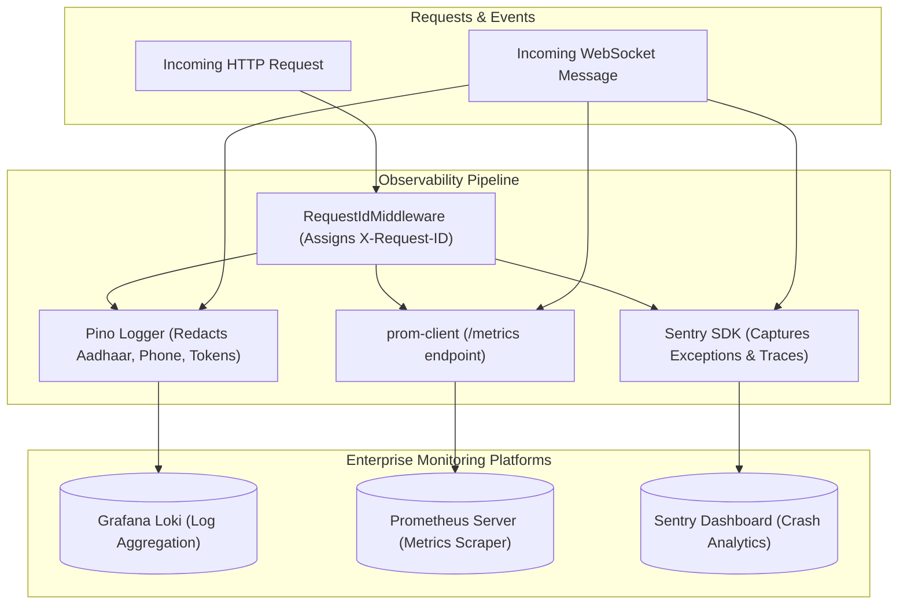

# Raftar Gaddi – Backend Engineering Audit
# Document 13: Observability, Telemetry & Logging Audit

**Audit Date:** November 2026  
**Auditor:** Senior Site Reliability Engineer (SRE) & Observability Specialist  
**Component:** Pino Structured Logging, Request Correlation, PII Redaction, Prometheus Metrics, and Sentry APM

---

## 1. Observability Architecture Overview

Telemetry in Raftar Gaddi is currently limited to structured HTTP logging provided by `nestjs-pino` in [`src/app.module.ts`](file:///home/hp/Applications/RaftarGadi/RaftarGadi-Backend/src/app.module.ts#L44-L78):
- Structured JSON output in production; `pino-pretty` formatting in development.
- Header and body sanitization for select sensitive fields.
- Health check probes mounted in `HealthModule` via `@nestjs/terminus`.

---

## 2. Critical Observability & Monitoring Deficiencies

### 2.1 The Broken Correlation ID Chain (`requestId: 'unknown'`)
In [`src/common/middleware/request-id.middleware.ts`](file:///home/hp/Applications/RaftarGadi/RaftarGadi-Backend/src/common/middleware/request-id.middleware.ts#L6-L17):
```typescript
@Injectable()
export class RequestIdMiddleware implements NestMiddleware {
  use(req: Request, res: Response, next: NextFunction) {
    const requestId = (req.headers['x-request-id'] as string) || uuidv4();
    req.id = requestId;
    res.setHeader('X-Request-ID', requestId);
    next();
  }
}
```
#### Defect:
- As documented in Document 01, **`RequestIdMiddleware` was never registered in `AppModule` or `main.ts`**.
- In [`src/common/filters/global-exception.filter.ts`](file:///home/hp/Applications/RaftarGadi/RaftarGadi-Backend/src/common/filters/global-exception.filter.ts#L73):
  ```typescript
  requestId: (request as unknown as Record<string, unknown>).id || 'unknown',
  ```
- Because the middleware never runs, `req.id` is always `undefined`.
- **Result:** Every single log message and error envelope reports `requestId: 'unknown'`.
- Debugging production outages across distributed requests, WebSocket gateways, and BullMQ worker jobs is virtually impossible because log traces cannot be correlated.

---

### 2.2 Inadequate PII Sanitization & Data Masking
In [`src/app.module.ts`](file:///home/hp/Applications/RaftarGadi/RaftarGadi-Backend/src/app.module.ts#L59-L68):
```typescript
redact: {
  paths: [
    'req.headers.authorization',
    'req.body.otp',
    'req.body.password',
    'req.body.refreshToken',
    'req.body.token',
  ],
  censor: '[REDACTED]',
},
```

#### Deficiencies in Redaction:
1. **Unmasked Aadhaar Numbers:** Driver KYC submissions contain `req.body.aadhaarNumber`. These 12-digit Indian national identity numbers are printed in clear text in log files, directly violating Indian UIDAI data compliance laws.
2. **Unmasked Phone Numbers:** Customer and driver phone numbers (`req.body.phone`) appear unredacted in access logs.
3. **URL Query Leaks:** Tokens passed in query parameters (e.g. WebSocket handshake query `?token=...`) are not redacted in `req.url`.

---

### 2.3 Complete Absence of Prometheus Metrics & APM
The backend contains **zero instrumentation for time-series metrics or Application Performance Monitoring (APM)**:
- **No Metrics Exporter:** Neither `prom-client` nor `@willsoto/nestjs-prometheus` is installed.
- **No Golden Signals:**
  - **Latency:** No histogram tracking HTTP route response times ($p_{50}, p_{95}, p_{99}$).
  - **Traffic:** No counter for incoming requests/sec by route and status code.
  - **Errors:** No metric tracking error rates or 5xx spikes.
  - **Saturation:** No monitoring of Node.js event-loop lag, V8 heap memory usage, or active WebSocket socket count.
- **No Real-Time Error Tracking:** No integration with **Sentry**, **Datadog**, or **New Relic**. Unhandled exceptions in background workers fail silently without alerting on-call engineers.

---

## 3. Observability Remediation Plan



1. **Mount `RequestIdMiddleware`:** Bind globally in `AppModule` via `configure(consumer: MiddlewareConsumer)`.
2. **Expand Pino Redaction Rules:** Add `req.body.aadhaarNumber`, `req.body.licenseNumber`, and sanitize query strings in `req.url`.
3. **Install `@willsoto/nestjs-prometheus`:** Expose standard `/metrics` endpoint for Prometheus/Grafana monitoring.
4. **Integrate `@sentry/nestjs`:** Automatically capture unhandled 500 exceptions, database timeout traces, and BullMQ worker failures.
