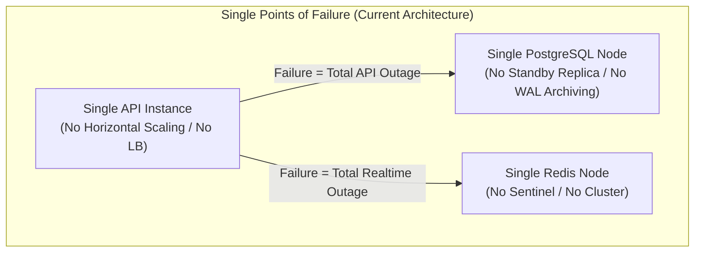

# Raftar Gaddi – Backend Engineering Audit
# Document 17: Reliability, Resilience & Disaster Recovery Audit

**Audit Date:** November 2026  
**Auditor:** Principal Site Reliability Engineer (SRE) & Resilience Architect  
**Component:** High Availability, Single Points of Failure, Graceful Shutdown, Backup Strategies, RTO/RPO Targets, and Cascading Failure Protection

---

## 1. Reliability Architecture Overview

On-demand logistics platforms require **99.95% minimum availability** (under 4.38 hours of unscheduled downtime per year). Drivers and customers rely on the system for live navigation, in-transit deliveries, and immediate payments.

An audit of the infrastructure and application lifecycle reveals that the platform is currently **highly brittle, lacking basic failover, graceful termination, and disaster recovery automation**.

---

## 2. Critical Reliability Deficiencies & SPOFs

### 2.1 Single Points of Failure (SPOF) Topology
The entire platform relies on single, un-replicated components:

1. **PostgreSQL SPOF:** If the single Postgres container or underlying EBS volume corrupts, the entire business halts.
2. **Redis SPOF:** If Redis restarts, all active driver locations, OTP states, and queue jobs are wiped, breaking real-time dispatch.
3. **Application Instance SPOF:** Running a single `api` container means any uncaught Node.js fatal exception causes complete system downtime until Docker restarts the container.

---

### 2.2 Disabled Graceful Shutdown Hooks (`enableShutdownHooks` Missing)
In [`src/main.ts`](file:///home/hp/Applications/RaftarGadi/RaftarGadi-Backend/src/main.ts#L10-L103):
- **Critical Omission:** `app.enableShutdownHooks()` is **never called**.
- **NestJS Behavior:** By default, NestJS **does not listen for OS termination signals (`SIGTERM`, `SIGINT`)**.
- **Consequences During Redeployment / Scaling:**
  1. When Docker or Kubernetes initiates a deployment, it sends `SIGTERM` to the container.
  2. Because shutdown hooks are disabled, NestJS ignores `SIGTERM`.
  3. The container orchestrator waits 30 seconds and forcefully kills the process with `SIGKILL`.
  4. **Active database transactions are killed mid-flight**, causing partial updates, dangling records, and orphaned lock states.
  5. WebSocket clients are severed abruptly without clean socket closure packets.
  6. In [`src/modules/bookings/services/bookings.service.ts`](file:///home/hp/Applications/RaftarGadi/RaftarGadi-Backend/src/modules/bookings/services/bookings.service.ts#L51-L55), `onModuleDestroy()` is never triggered, leaking background timers.
- **Remediation:** Add `app.enableShutdownHooks()` immediately after `NestFactory.create()` in `main.ts`.

---

### 2.3 Disaster Recovery Targets (RTO / RPO) & Backup Gaps

| Metric | Current State | Production Standard | Gap |
|---|---|---|---|
| **Recovery Point Objective (RPO)** | **24+ Hours** (Manual `pg_dump` only) | **$\le$ 5 Minutes** | 24 hours of data loss risk. |
| **Recovery Time Objective (RTO)** | **4–8 Hours** (Manual server rebuild) | **$\le$ 15 Minutes** | Extended business downtime. |
| **WAL Archiving** | Disabled | Enabled (Continuous replication to S3) | Point-in-time recovery missing. |
| **Redis Persistence** | Default snapshotting only | AOF (Everysec) + RDB snapshots | Loss of recent queue/telemetry states. |
| **Disaster Recovery Testing** | Never tested | Quarterly automated restore drills | High risk of failed restoration. |

---

### 2.4 Missing Circuit Breakers on Third-Party Dependencies
Raftar Gaddi depends on external third-party APIs:
- SMS Gateway (Twilio / MSG91)
- Driving License & Aadhaar Verification (Zoop / Setu / Surepass)
- Payment Gateway (Razorpay / Stripe)

#### Cascading Failure Hazard:
- Calls to third-party APIs are executed using standard HTTP requests without **timeouts** or **circuit breakers** (such as `opossum`).
- If Razorpay or Setu suffers an outage and takes 45 seconds to respond:
  - Node.js threads block waiting for socket responses.
  - Incoming requests pile up in memory.
  - The entire backend experiences a **cascading collapse**, even though the core database and internal services are perfectly healthy.
- **Remediation:** Wrap all third-party integrations with explicit 5-second timeouts and circuit breakers that fail fast and trigger graceful fallback paths.

---

## 3. Resilience Upgrade Action Plan

1. **Activate Graceful Shutdown:** Add `app.enableShutdownHooks()` in `main.ts` and handle `SIGTERM` in `worker.ts`.
2. **Deploy Managed Multi-AZ Database:** Migrate from local Docker PostgreSQL to **AWS RDS PostgreSQL (Multi-AZ)** with automated continuous point-in-time recovery (PITR).
3. **Deploy Managed Redis Cluster:** Migrate to **AWS ElastiCache Redis** with multi-AZ failover and append-only file (AOF) persistence.
4. **Implement Circuit Breakers:** Wrap payment and KYC service methods with `opossum` circuit breakers.
